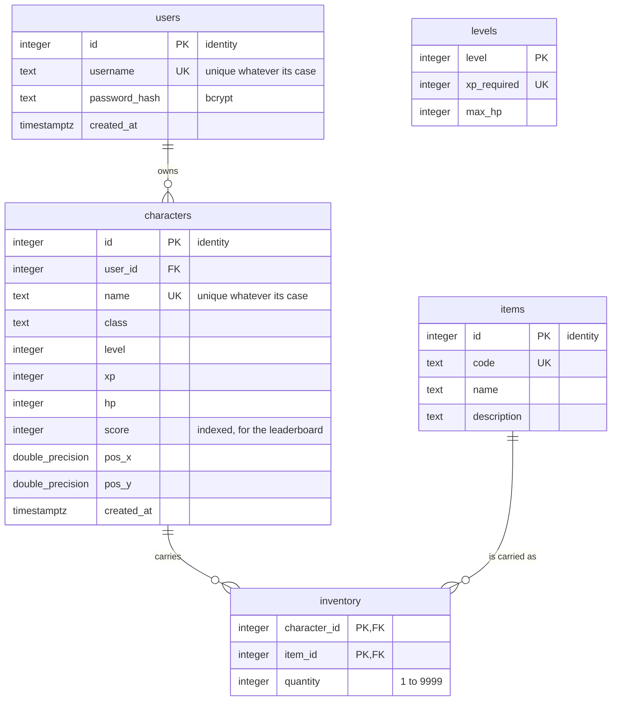

# Database schema

PostgreSQL 18. Created by the migrations in `server/pg/migrations/`.

`levels` stands alone: it is the XP table, read once at startup. Sessions,
rate-limit counters and the leaderboard index live in Redis, not here.
"Unique whatever its case" is an index on `lower(...)`, so "Alice" and
"alice" are the same name.